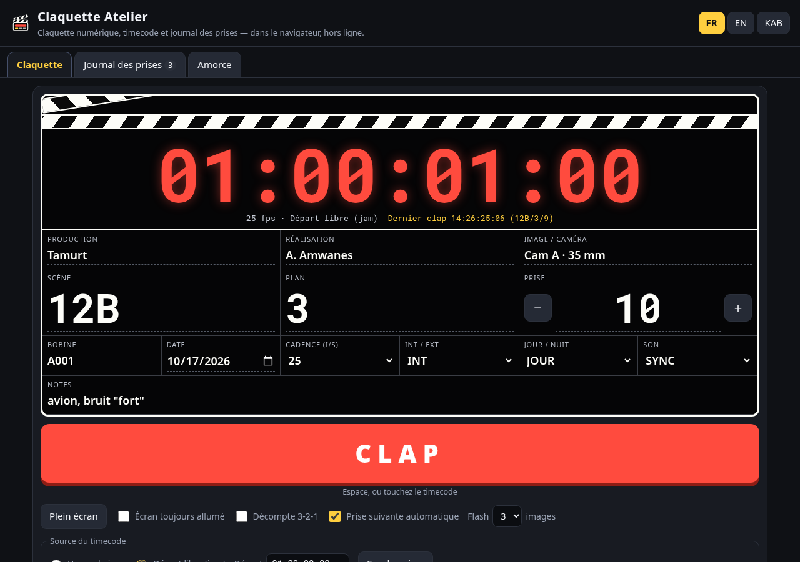
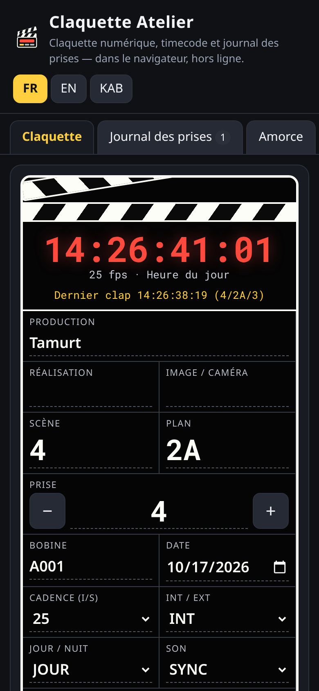
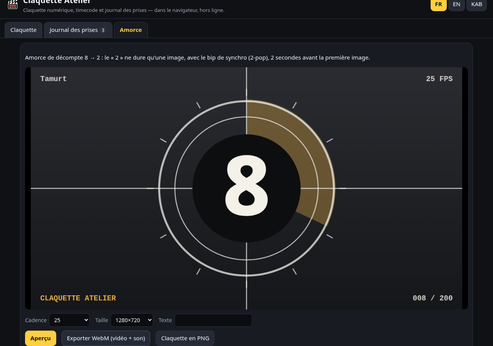

# Claquette Atelier — claquette numérique, timecode et journal des prises



**🇫🇷** Une **claquette numérique** (clap / slate) pour cinéastes et vidéastes, **100 % dans le navigateur** : timecode qui défile à la bonne cadence (y compris **29,97 drop-frame**), gros bouton **CLAP** qui fait un **flash blanc de quelques images + un bip** pour synchroniser image et son, **journal des prises** (bonne / NG / cerclée, notes) exportable en **CSV** et **JSON**, et générateur d'**amorce de décompte 8 → 2 avec 2-pop** exportée en **vidéo WebM avec son**. Sans installation, sans compte, **fonctionne hors ligne** sur téléphone ou tablette.
**🇬🇧** A free, offline, in-browser **digital clapperboard**: running timecode (incl. 29.97 drop-frame), CLAP with a frame-accurate white flash + beep, take log with CSV/JSON export, and a countdown leader with 2-pop exported as WebM. English section below.
**ⵣ Taqbaylit** : tigezmi ddaw-a.

👉 **Démo : https://salimadour31-boop.github.io/claquette-atelier/**

 

## Pour qui ?
- **Tournages légers, courts-métrages, écoles de cinéma, clips, YouTube** : pas de vraie claquette sous la main ? Le téléphone devant l'objectif fait l'affaire.
- **Ingénieurs du son / monteurs** : le flash et le bip tombent sur la même image ; le timecode affiché et le journal des prises aident à retrouver les rushes.
- **Scripts** : journal des prises (bonne / NG / cerclée + notes) exporté en tableur.

## Mode d'emploi
1. Ouvrez la [démo](https://salimadour31-boop.github.io/claquette-atelier/) sur le téléphone (Chrome, Firefox, Safari, Edge récents). Ajoutez-la à l'écran d'accueil pour l'avoir **hors ligne**.
2. Remplissez la claquette : production, réalisation, image/caméra, **scène, plan, prise**, bobine, date, **cadence** (23,976 · 24 · 25 · 29,97 DF · 29,97 NDF · 30 · 50 · 60), INT/EXT, JOUR/NUIT, SYNC/MOS, notes. Tout est mémorisé sur l'appareil.
3. **Source du timecode** : *Heure du jour* (calé sur l'horloge du téléphone) ou *Départ libre (jam)* : tapez par ex. `01:00:00:00` et **Synchroniser**.
4. **Plein écran**, luminosité au maximum, cochez **Écran toujours allumé** (Wake Lock).
5. Devant la caméra : **CLAP** (bouton, **barre d'espace**, ou **toucher le timecode**). Flash blanc de 1 à 6 images (3 par défaut) + bip ; le timecode du clap reste figé 2 s et la prise est **ajoutée au journal**. Option **décompte 3-2-1** ; la **prise suivante** s'incrémente toute seule (`7` → `8`, `07` → `08`, `A` → `B`).
6. Onglet **Journal des prises** : notez ✓ Bonne / ✕ NG / ◯ cerclée, ajoutez une note, **Exporter CSV** (Excel, LibreOffice, Google Sheets) ou **JSON** ; **Effacer le journal** (avec confirmation).
7. Onglet **Amorce** : choisissez cadence, taille (720p, 1080p, vertical 1080×1920) et texte, **Aperçu**, puis **Exporter WebM (vidéo + son)** ; **Claquette en PNG** exporte une image de la claquette (à poser en début de plan au montage).

## Fonctions
- Timecode `HH:MM:SS:FF` à la cadence choisie, notation **drop-frame** `HH:MM:SS;FF` en 29,97 DF, passage de minuit (24 h).
- Le timecode est « jammé » à un instant puis avance à la **vraie cadence** : en 23,976 et 29,97 NDF il dérive donc de 3,6 s/heure par rapport à l'horloge, comme un vrai générateur (re-synchronisez avec **Synchroniser**).
- Flash et bip générés sans aucun fichier (Web Audio) ; le flash est retardé de la latence audio annoncée par le navigateur pour tomber avec le son.
- Amorce : 8 → 3 une seconde chacun avec un balayage, **« 2 » affiché une seule image avec le bip 1 kHz d'une image (2-pop)**, puis noir jusqu'à la première image, 2 s après le pop.
- Interface **français / English / Taqbaylit**, thème sombre à fort contraste, mobile d'abord (portrait et paysage), clavier et lecteurs d'écran (libellés, `aria`), **PWA hors ligne** (manifest + service worker), polices système, aucune ressource externe, **aucun traceur**, aucune donnée envoyée.

## Tests
- **10 tests unitaires** (`npm test`, `node:test`, sans dépendance) : timecode 24, 25, 30, 23,976, **29,97 DF** (images sautées, dixième minute, 107 892 images/heure, aller-retour), **passage à 24 h**, incrément de prise, **échappement CSV** (virgules, guillemets, retours ligne, formules neutralisées), export JSON, **calendrier de l'amorce** (2-pop sur la bonne image à chaque cadence, 2 s avant l'action).
- **Test de bout en bout** (`tests/e2e.mjs`, Playwright/Chromium) : chargement, langues FR/EN/Taqbaylit, timecode qui défile, saisie de la scène, **CLAP** (durée du flash mesurée ≈ 3 images), prise enregistrée et incrémentée, barre d'espace, toucher, affichage DF, jam, notation des prises, **téléchargement CSV/JSON** vérifié, persistance après rechargement, **export WebM** (en-tête EBML + piste Opus), PNG, effacement, **mobile 390×844 sans débordement horizontal** (portrait et paysage), **aucune erreur console**.
- CI GitHub Actions à chaque commit.

```bash
npm test                                      # tests unitaires
npm install --no-save playwright@1.48.2 && npx playwright install chromium
node tests/e2e.mjs                            # test navigateur (écrit aussi les captures)
```

## Limites
- **Pas de vrai timecode SMPTE/LTC** en entrée ni en sortie : le timecode vient de l'horloge du téléphone ou d'un départ saisi à la main ; la précision dépend de l'horloge de l'appareil et de l'affichage (60 Hz : un flash de 3 images à 25 i/s dure ~7 rafraîchissements d'écran).
- Le flash et le bip sont alignés au mieux par le navigateur (latence audio Bluetooth = décalage : utilisez le haut-parleur du téléphone).
- **Export WebM** : nécessite MediaRecorder avec WebM (Chrome, Edge, Firefox ; pas Safari iOS ancien) ; l'enregistrement se fait en temps réel (8 s) et la vidéo est à cadence variable : ré-encodez en cadence fixe si votre logiciel l'exige (`ffmpeg -i amorce.webm -r 25 amorce.mp4`).
- Le Wake Lock et le plein écran dépendent du navigateur (sur iPhone, le plein écran est simulé en CSS).

---

## 🇬🇧 English
**Claquette Atelier** is a free (MIT), offline, mobile-first **digital clapperboard / slate** for filmmakers and videographers. Fill in production, director, DOP/camera, scene, shot, take, roll, date, frame rate (23.976 / 24 / 25 / 29.97 DF / 29.97 NDF / 30 / 50 / 60), INT/EXT, DAY/NIGHT, SYNC/MOS and notes. The running timecode comes from the time of day or from a jam-synced start (`01:00:00:00`…), with drop-frame `;` notation. Press **CLAP** (button, spacebar or tap the timecode): a full-screen white flash for a chosen number of frames plus a sharp Web Audio beep, the clap timecode freezes on screen, the take is logged and the take number auto-increments (optional 3-2-1 countdown). The **take log** (good / NG / circled, notes) is stored locally and exports to **CSV** and **JSON**. The **leader** tab renders an original countdown leader (8 → 2, single-frame "2" with a one-frame 1 kHz 2-pop, black until first frame of action 2 s later) and exports it as **WebM with audio** (MediaRecorder + canvas.captureStream + Web Audio); the current slate exports as **PNG**. Fullscreen, screen wake lock, PWA offline, FR/EN/Taqbaylit, no tracker, no external resource.
Tests: 10 Node unit tests (timecode incl. 29.97 DF and 24 h rollover, CSV escaping, leader schedule) and a Playwright end-to-end test (languages, CLAP, take log, CSV download, WebM export, 390×844 layout, no console errors). Limits: no LTC/SMPTE in/out, accuracy bounded by the device clock and display refresh, WebM export needs MediaRecorder (not older iOS Safari) and produces variable-frame-rate files.

## ⵣ Taqbaylit
**Claquette Atelier** d taklakit tumḍint n baṭel (MIT) i yimeskaren n usaru d tvidyut, srid deg yiminig, war Internet. Aru afares, anemhal, asayes, tamuɣli, tuṭṭfa, abubin, azemz d urured (fps) ; timecode yettazal s urured i tferneḍ (s 29,97 DF daɣen). Sit ɣef **CLAP** (neɣ tallunt, neɣ sit ɣef timecode) : aflac amellal kra n tugniwin d ubip, timecode n uclap ad yeqqim yettwasbedd, tuṭṭfa ad tettwasekles deg **uɣmis n tuṭṭfiwin**, tuṭṭfa d-iteddun ad tettwarnu s wudem awurman. Aɣmis yettwasifeḍ s CSV d JSON. Iccer **Amḍan** yessufuɣ amḍan 8 → 2 s ubip 2-pop s tavidyut WebM (s yimesli), taklakit s PNG. Ulac amiḍan, ulac aḍfar.

## Licence
MIT © 2026 salimadour31-boop. Aucune dépendance à l'exécution ; Playwright (Apache-2.0) ne sert qu'aux tests.
